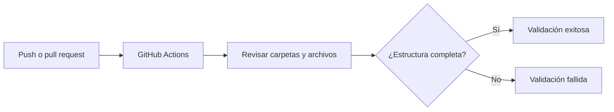

# MyProyectoDevOps 🚀

[](https://github.com/Ryob1239/MyProyectoDevOps/actions/workflows/validar-estructura.yml)


**Plantilla de repositorio para una práctica académica de DevOps**, organizada por componentes y con una validación automática de estructura mediante GitHub Actions.

Este proyecto permite aprender a documentar un repositorio, separar responsabilidades y utilizar Git y GitHub para controlar cambios. Es una **base de trabajo**, no una aplicación lista para ejecutarse en producción.

> **Estado actual:** estructura inicial y automatización de comprobación de archivos. Las carpetas de aplicación todavía contienen marcadores `.gitkeep`; no hay una API, interfaz web o base de datos implementadas ni pruebas funcionales configuradas.

**Repositorio:** [Ryob1239/MyProyectoDevOps](https://github.com/Ryob1239/MyProyectoDevOps)  
**Rama principal:** `main`  
**Tipo de proyecto:** académico / introductorio a DevOps

## 1. Objetivo

Organizar los elementos habituales de un proyecto de software para facilitar su evolución hacia un flujo de trabajo DevOps con documentación, colaboración y validaciones automáticas.

### Objetivos específicos

- Mantener separadas las áreas de *backend*, *frontend*, base de datos, documentación e imágenes.
- Documentar el propósito y uso del repositorio mediante `README.md`.
- Registrar reglas de exclusión en `.gitignore` para evitar archivos temporales y secretos locales.
- Incluir un archivo de licencia para establecer las condiciones de reutilización.
- Comprobar automáticamente que la estructura mínima se mantenga en cada cambio a `main`.

## 2. Características implementadas

| Funcionalidad | Estado | Descripción |
|---|---|---|
| Organización por módulos | ✅ Implementada | Carpetas específicas para las principales áreas del proyecto. |
| Documentación del repositorio | ✅ Implementada | README y material de investigación en `docs/`. |
| Exclusión de archivos locales | ✅ Implementada | Patrones de `.gitignore` para Python, Node.js, variables de entorno y temporales. |
| Validación con GitHub Actions | ✅ Configurada | Verifica la existencia de carpetas y archivos requeridos. |
| Backend, frontend y base de datos | 🗓️ Pendientes | Por ahora solo se reservan sus directorios. |
| Pruebas unitarias y despliegue | 🗓️ Pendientes | Se incorporarán cuando exista código de aplicación. |

## 3. Estructura del proyecto

```text
MyProyectoDevOps/
├── .github/
│   └── workflows/
│       └── validar-estructura.yml
├── backend/
│   └── .gitkeep
├── database/
│   └── .gitkeep
├── docs/
│   └── INVESTIGACION_Y_EVIDENCIAS.md
├── frontend/
│   └── .gitkeep
├── images/
│   └── .gitkeep
├── .gitignore
├── LICENCE
└── README.md
```

| Ruta | Propósito |
|---|---|
| `backend/` | Almacenar en el futuro la lógica de negocio y los servicios del servidor. |
| `frontend/` | Incorporar posteriormente la interfaz de usuario. |
| `database/` | Guardar esquemas, migraciones y scripts de base de datos (nunca credenciales). |
| `docs/` | Conservar documentación técnica, investigación y evidencias académicas. |
| `images/` | Guardar capturas y recursos gráficos del proyecto. |
| `.github/workflows/` | Definir automatizaciones de integración continua con GitHub Actions. |
| `.gitignore` | Evitar que Git incorpore ciertos archivos no deseados. |
| `LICENCE` | Informar sobre los términos de licencia del proyecto. |
| `README.md` | Explicar el proyecto y orientar a nuevos colaboradores. |

**Nota:** `.gitkeep` es un archivo marcador; se utiliza porque Git no versiona directorios vacíos por sí solo.

## 4. Tecnologías y herramientas

- **Git:** seguimiento de cambios y trabajo por ramas.
- **GitHub:** alojamiento del código, historial, *issues* y *pull requests*.
- **GitHub Actions:** ejecución de la verificación automatizada.
- **YAML:** definición del flujo de trabajo de GitHub Actions.
- **Bash:** comandos para comprobar archivos y directorios en el ejecutor Linux.
- **Markdown:** documentación legible y renderizable en GitHub.

> No se requiere instalar Python, Node.js ni una base de datos para utilizar la estructura actual, pues todavía no existe una aplicación ejecutable.

## 5. Requisitos previos

Para trabajar de forma local se recomienda tener:

1. **Git** instalado.
2. Un editor de código, por ejemplo Visual Studio Code.
3. Acceso a una terminal (PowerShell, Git Bash o equivalente).
4. Una cuenta de **GitHub** solo si se desea colaborar o consultar las ejecuciones de Actions.

## 6. Instalación y primeros pasos

**Paso 1. Clonar el repositorio:**

```bash
git clone https://github.com/Ryob1239/MyProyectoDevOps.git
```

**Paso 2. Entrar al directorio:**

```bash
cd MyProyectoDevOps
```

**Paso 3. Revisar los archivos:**

En Git Bash o Linux/macOS:

```bash
ls -la
```

En PowerShell:

```powershell
Get-ChildItem -Force
```

**Paso 4. Consultar el material de la práctica:** abrir `README.md` y [`docs/INVESTIGACION_Y_EVIDENCIAS.md`](docs/INVESTIGACION_Y_EVIDENCIAS.md).

**Importante:** no existe un comando de arranque como `npm start` o `python app.py` en esta etapa. El objetivo actual es revisar y validar la estructura del repositorio.

## 7. Integración continua: GitHub Actions

El flujo [`validar-estructura.yml`](.github/workflows/validar-estructura.yml) se activa cuando ocurre cualquiera de los siguientes eventos:

- Un `push` a la rama `main`.
- Un `pull_request` dirigido a `main`.
- Una ejecución manual mediante `workflow_dispatch`.

### ¿Qué comprueba?

1. Descarga el contenido del repositorio con `actions/checkout@v4`.
2. Comprueba que existan `backend/`, `frontend/`, `database/`, `docs/`, `images/` y `.github/workflows/`.
3. Comprueba la presencia de `README.md`, `LICENCE`, `.gitignore` y del propio archivo de workflow.
4. Finaliza correctamente si todos los elementos están presentes; si falta alguno, el proceso falla y lo indica en el registro.



**Consultar resultados:** abrir la pestaña [Actions del repositorio](https://github.com/Ryob1239/MyProyectoDevOps/actions), seleccionar **Validar estructura del repositorio** y revisar la ejecución. El distintivo ubicado al inicio de este README enlaza al mismo flujo.

> **Alcance de la comprobación:** este workflow no instala dependencias, no ejecuta pruebas unitarias y no despliega una aplicación. Es una verificación básica de integridad estructural.

## 8. Documentación y evidencias

El archivo [`docs/INVESTIGACION_Y_EVIDENCIAS.md`](docs/INVESTIGACION_Y_EVIDENCIAS.md) explica el papel de `README.md`, `LICENCE` y `.gitignore`, describe la automatización.

## 9. Cómo contribuir

Este repositorio está planteado como práctica académica. Para proponer una mejora:

1. Crear una rama descriptiva: `git switch -c docs/mejorar-readme`.
2. Realizar cambios pequeños y coherentes con la estructura.
3. Revisar los cambios y guardar un commit: `git add .` y `git commit -m "docs: mejorar documentación"`.
4. Publicar la rama: `git push -u origin docs/mejorar-readme`.
5. Abrir un *pull request* hacia `main` y comprobar el resultado de GitHub Actions.

Se recomienda **no subir contraseñas, tokens, archivos `.env` ni bases de datos privadas**. Los cambios deben explicar qué se modificó y por qué.

## 10. Problemas frecuentes

| Situación | Posible solución |
|---|---|
| El workflow indica que falta una carpeta. | Restaurar la carpeta y su `.gitkeep`, subir el cambio y revisar Actions. |
| GitHub no muestra un archivo oculto. | Comprobar su nombre exacto (`.gitignore`, `.github`) y que esté confirmado en Git. |
| Un archivo ignorado sigue apareciendo en Git. | `.gitignore` no deja de rastrear archivos añadidos previamente; revisar `git rm --cached <ruta>` antes de confirmar. |
| No se puede iniciar la aplicación. | Es normal: todavía no se ha desarrollado una aplicación ejecutable. |

## 11. Próximas mejoras

- Incorporar una aplicación pequeña en `backend/` y `frontend/`.
- Añadir pruebas automáticas (por ejemplo, Pytest o pruebas de frontend según la tecnología elegida).
- Ampliar la integración continua con revisiones de calidad y seguridad.
- Preparar una estrategia de despliegue cuando exista un producto funcional.
- Agregar ejemplos de configuración sin incluir información sensible.

Estas características son propuestas de evolución, **no funcionalidades ya desarrolladas**.

## 12. Licencia

El archivo [`LICENCE`](LICENCE) incluye el texto base de la **licencia MIT**. Se conserva el nombre `LICENCE`.

## 13. Autor y mantenimiento

**Felipe Torres Molina**  
Proyecto académico de DevOps · 2026  
**Canal para reportar problemas o sugerencias:** [Issues de MyProyectoDevOps](https://github.com/Ryob1239/MyProyectoDevOps/issues).

## 14. Referencias de documentación

- [GitHub Docs — Acerca de los archivos README](https://docs.github.com/es/repositories/managing-your-repositorys-settings-and-features/customizing-your-repository/about-readmes).
- [GitHub Docs — Buenas prácticas para repositorios](https://docs.github.com/en/repositories/creating-and-managing-repositories/best-practices-for-repositories).
- [Google Style Guides — READMEs](https://google.github.io/styleguide/docguide/READMEs.html).

---

_Este README describe únicamente los elementos presentes en la versión revisada del repositorio y distingue las funciones actuales de las planeadas._
